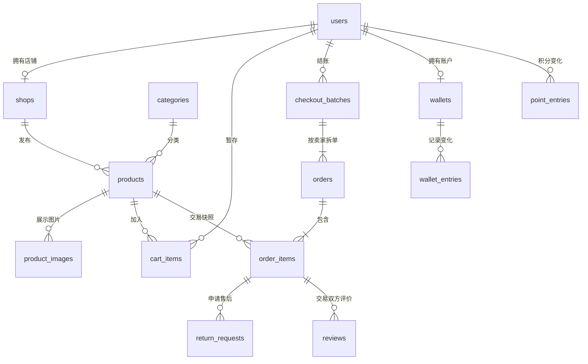

# 数据库设计

## 目标与状态

为注册审核、商品交易、资金积分、售后及管理功能提供清晰的数据结构。本文件是设计提案，尚未创建数据库或执行SQL；详细字段约束将随最终设计确认后形成建表脚本。

数据库名为已确认的`2024011490`。创建和使用数字名称的数据库时，SQL中用反引号引用名称。采用MySQL 8.0、InnoDB事务和utf8mb4字符集。

## 表与职责提案

| 表 | 中文含义 | 核心字段与约束 |
|---|---|---|
| users | 用户 | 主键、账号、密码摘要、用户类型、审核状态、姓名、手机号、邮箱、城市、性别、16位银行账号、可用积分、冻结积分、删除标记；账号唯一 |
| shops | 店铺 | 主键、卖家编号、店名、营业状态、商家等级、等级模式；卖家编号唯一，个人卖家无商家等级 |
| categories | 商品类别 | 主键、名称、排序号 |
| products | 商品 | 主键、店铺及类别编号、名称、原价、折扣、实际售价、尺寸、使用说明、可议价、新旧程度、库存、状态、审核意见 |
| product_images | 商品图片 | 主键、商品编号、上传文件编号、展示顺序 |
| uploaded_files | 上传文件 | 主键、上传者、用途、内部存储名、原文件名、内容类型、大小、创建时间；区分公开商品图与私有证件 |
| cart_items | 购物车明细 | 主键、买家编号、商品编号、数量；买家与商品组合唯一 |
| checkout_batches | 结账批次 | 主键、买家编号、幂等请求号、总商品额、实付额、使用积分、创建时间；买家与幂等号组合唯一 |
| orders | 卖家订单 | 主键、结账批次、买卖双方、店铺、订单号、状态、约定时间地点、交付及确认时间、费率快照、取消原因 |
| order_items | 订单商品明细 | 主键、订单和商品编号、商品名及售价快照、购买数量、分摊实付款和抵扣积分、奖励积分、手续费、结算解冻状态 |
| return_requests | 退货申请 | 主键、订单明细、买家、原因、审核状态及意见、申请及审核时间、退款时间、交回时间 |
| reviews | 交易评价 | 主键、订单明细、评价方向、评价人及被评价人、商品星级、服务星级或买家行为星级、文字；同明细同方向不重复评价 |
| blacklists | 黑名单 | 主键、范围、操作方、买家、原因、生效状态、解除时间；店铺范围保存店铺编号，平台范围不属于单一店铺 |
| wallets | 资金账户 | 主键、用户编号或平台账户类型、可用余额、冻结余额；用户账户唯一，平台托管和手续费分别记账 |
| wallet_entries | 资金流水 | 主键、业务编号、账户编号、流水类型、可用及冻结余额变动、关联订单或售后编号、操作人、创建时间；业务唯一键防重复记账 |
| point_entries | 积分流水 | 主键、用户、业务编号、可用及冻结积分变动、订单明细或售后关联、创建时间；唯一业务键防重复发积分 |
| audit_logs | 审计及资料变更 | 主键、操作人、操作类型、对象类型及编号、变更前后摘要、创建时间；不保存密码、证件或完整银行账号明文到日志 |

共17张职责明确的表，其中资金、积分和审计流水用于解释实际余额变化，避免只存最终数字而无法追踪退款。

## 主要关系

用户与商品通过购物车明细、购买明细形成多对多关系。订单明细保存历史快照，商品后续编辑不能改变已经支付订单的金额和商品名。

## 数据精度与一致性

- 金额使用DECIMAL及Java BigDecimal，精确至分；不能使用float或double计算钱款。
- 银行账号使用字符类型保留前导零，由参数校验和数据库长度约束共同保证16位数字。
- 库存、积分使用整数，扣减通过事务和带非负条件的更新执行。
- 订单状态变更使用原状态条件，定时任务与人工确认只能有一个成功。
- 同次结账涉及账户及商品时，按固定编号顺序加锁，减少并发死锁；失败整体回滚。
- 冻结金额按订单明细记录可释放数，不能仅凭钱包总冻结额判断某笔交易是否可退款。
- 对交易用户、历史订单的引用应保留，用户删除策略作为待确认的细节，不在本阶段执行真实删除。

## 下一步

最终设计审阅时确认页面字段、删除策略、评价时点和金额分摊细则，再生成具体建表SQL、索引与种子数据。
